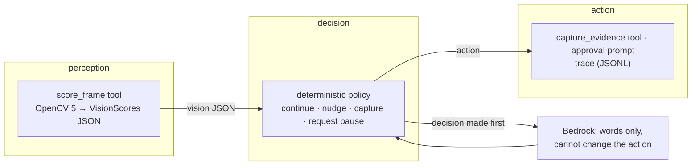

# Addendum — Agentic Vision

## Workflow diagram



## The tools

`GET /api/tools` serves the registry verbatim. Four tools, each with a JSON
input schema and a single output key:

- `probe_source` (`{source}` → `info`): can this source be read, at what
  fps and resolution.
- `detect_roi` (`{frame_index}` → `roi`): print-bed region from gradient
  energy.
- `score_frame` (`{frame_index, t_ms}` → `scores`): the OpenCV 5 pipeline
  over one frame.
- `capture_evidence` (`{frame_index, note?}` → `evidence_uri`): clip plus
  still plus measurement JSON around the alert.

The loop reaches the pipeline only through `call_tool("score_frame", …)`,
so the trace records tool calls, not inline function calls.

## The trace that proves vision changes the action

The property, measured (`eval/run_eval.py::check_threshold_flip`):
`spaghetti_score` 0.71 → action `capture_evidence`; `spaghetti_score` 0.73
→ action `request_pause_approval`; everything else identical; delta 0.02.

A real excerpt — ten consecutive lines of
`.evidence/runs/eval-failure-pauses-and-asks/trace.jsonl`, spanning the
alert (scores rise, the action flips, evidence is stored):

```
266 tool_call evidence-stored (capture_evidence)
267 action act performed=capture_evidence
268 tool_call perceive score_frame
269 perception perceive scores.spaghetti=0.78
270 decision decide action=request_pause_approval
271 tool_call evidence-stored (capture_evidence)
272 action act performed=request_pause_approval
273 tool_call perceive score_frame
274 perception perceive scores.spaghetti=0.81
275 decision decide action=request_pause_approval
```

`tool_call score_frame` → its JSON → `decision` → `action`, line by line.

## Human control

A `request_pause_approval` decision captures evidence, emits
`await-approval` with an `approval_id`, and awaits the human (120 s timeout;
a timeout records `approved: false` and the run continues — nothing is
actuated either way, REQ-N12). The UI renders an `alertdialog` with Approve
pause / Keep printing. The resolution is emitted as `approval-resolved` and
stored on the approval record.

## Task success, failure handling, observability

Axis scores from `eval/results/eval-report.json`: task_effectiveness 4/4,
failure_handling 3/3, observability 4/4, human_control 1/1. Four
fault-injection cases: `degrade_every_frame` (silence, not guessing),
`raise_at_frame_30` (crash ≠ run death), `evidence_write_fails` (alert
survives vault loss), `approver_never_answers` (timeout recorded, clean end).
Observability checks on a live failure run: every `decide` has an earlier
`perceive` with the same frame; tool calls outnumber decisions and name only
registry tools; every decision validates against the frozen schema.

## Security

IAM least-privilege (S3 scoped to the evidence bucket, Bedrock scoped to one
model). No secrets in the image, the repo, logs, or envelope payloads
(`submit hygiene` scans). Uploads capped at 200 MB with a `video/*`
content-type check; the evidence route rejects `..`; approval ids are
unpredictable and single-use.
