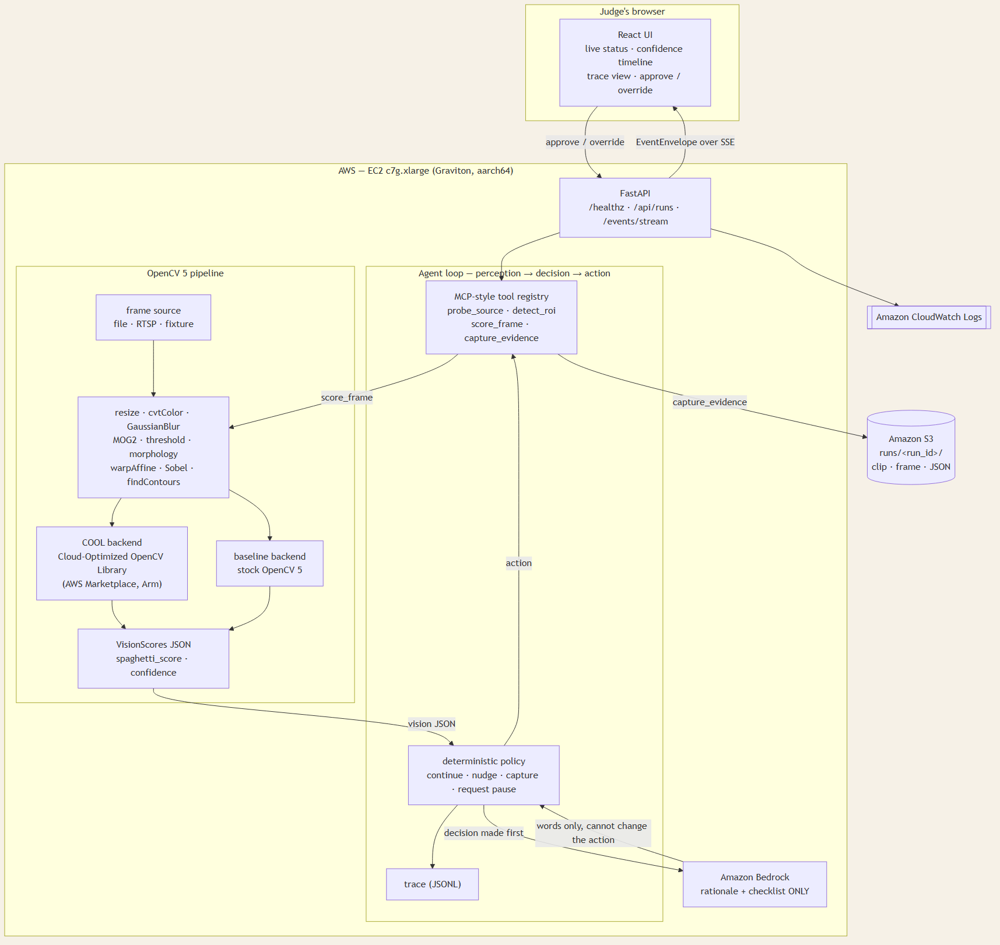

# Technical report — Spaghetti Sentinel

## Problem

Maya starts a 6-hour print before bed. At hour 4 the part detaches, the
nozzle keeps extruding, and she wakes to a bird's nest of filament welded to
the hotend — a lost print, a lost night, and sometimes a dead nozzle. The
existing workarounds are a webcam she won't watch at 3 AM, timelapse reviews
after the damage, and cloud detectors with subscriptions she doesn't want.
What she needs is a watcher that taps her shoulder the moment the print
fails, with footage proving it.

## Users

One persona: Maya, the solo desktop tinkerer. She needs 60-second setup, a
status she can read on her phone, and a pause recommendation she can trust
because it arrives with the clip, not a bare alarm. This is explicitly not
for print farms or industrial QA: one camera, one printer, one human who
decides.

## Architecture

A FastAPI service drives an agent loop (perception → decision → action).
Frames flow from file, RTSP or fixture through the OpenCV 5 pipeline
(`app/vision/pipeline.py`), which emits `VisionScores` JSON. The deterministic
policy (`app/agent/policy.py`) is a pure function of that JSON: the same
scores always yield the same action. The language model (Amazon Bedrock) runs
*after* the decision exists and can only add words — a rationale paragraph
and a triage checklist. It cannot change the action, the threshold, or the
reason code; `RationaleResult` structurally carries no action field, and
`test_llm_cannot_change_action` proves a model arguing otherwise is ignored
by construction. Module boundaries: `app/vision` owns every `cv2` call,
`app/evidence` owns every S3 call, `app/rationale` owns every Bedrock call,
`app/api` owns every `EventEnvelope`.

## OpenCV 5 implementation

Nine operations, in pipeline order: `resize` → `cvt_gray` →
`gaussian_blur` → `bg_subtract` (MOG2) → `threshold` → `morphology`
(open, close) → `warp_affine` (phase-correlation stabilisation, ±24 px clamp)
→ `sobel` (edge-regularity histogram, 36 bins) → `find_contours`. Scores
(`app/vision/pipeline.py::analyze_frame`): `first_layer_coverage` (bed
coverage vs the first observed layer), `edge_regularity` (1 − entropy of
gradient angles), `motion_energy` (frame differencing), `texture_disorder`
(windowed differencing × blob count), fused as `spaghetti_score = 0.40·td +
0.30·(1−er) + 0.20·me + 0.10·coverage_term`, with a deterministic
warmup·lighting·support confidence product. Every frame is resized to
960×540 first, so scores are resolution-independent. The COOL/baseline
backend switch (`app/vision/backend.py::get_backend`) probes for the COOL
build at runtime and falls back to stock OpenCV 5 with a warning; the active
backend and `accelerated_ops` are reported, not asserted. OpenCV major
version 5 is enforced by test and by a startup check (competition rule MT-1).

## AWS deployment

`c7g.xlarge` (Graviton, `aarch64`), Amazon Linux 2023 AMI resolved via SSM at
deploy time, single-architecture `linux/arm64` image, region `us-east-1`.
Evidence layout in S3: `runs/<run_id>/{clip,frame}-<n>.{mp4,png}` plus
`scores/decision/summary/trace.json`. Bedrock supplies rationale text only.
CloudWatch carries container logs. IAM is least-privilege: S3 scoped to the
evidence bucket prefix, `bedrock:InvokeModel` scoped to the configured
model, ECR pull, log writes — no wildcard resources. Deploy:
`bash deploy/deploy_ec2.sh`; verify:
`bash deploy/healthcheck.sh --url <url> --marker "$(head -1 build-marker.txt)"`.

## Evaluation

Full report: `eval/results/eval-report.md`. Axes: task_effectiveness 4/4,
failure_handling 3/3, observability 4/4, human_control 1/1 — 9/9 cases passed
(1 skipped: no real footage present). Detection latency on the failure clip:
18 frames (0.6 s) against a 45-frame budget. The threshold-flip property:
`spaghetti_score` 0.71 → `capture_evidence`, 0.73 →
`request_pause_approval`, everything else identical (delta 0.02). Fault
injections prove degraded frames never escalate, a mid-run crash doesn't end
the run, evidence loss doesn't lose the alert, and an unanswered prompt is
recorded as unanswered.

## Limitations

- Three of the four labelled clips are synthetic and were generated by this
  repository; they exercise the pipeline's discrimination, not real-world
  lighting, camera noise or printer variety.
- The scoring weights in app/vision/pipeline.py are fixed constants chosen
  by inspection, not learned from a labelled dataset; they are a heuristic,
  not a trained model.
- Detection latency is measured in sampled frames at sample_every_n=3, so
  the reported latency is granular to 3 source frames (0.1 s at 30 fps).
- The system recommends a pause; it never actuates one. Any claim of saved
  filament is modelled from the detection frame, not measured on a printer.
- Confidence is a deterministic penalty product, not a calibrated
  probability; it should not be read as 'this many percent of such alerts
  are real'.
- No adversarial or occlusion cases are evaluated (a hand entering frame,
  the camera moving mid-print beyond the stabiliser's ±24 px clamp).
- The COOL benchmark on record is non-authoritative (local host, no COOL
  build); the authoritative Graviton run is pending deployment.

## Responsible use

This system recommends; it never controls the printer. It cannot pause, stop
or modify a print. A pause recommendation is shown to a person, who decides.
Demo footage is synthetic and watermarked. The system sees only the video
source — no audio, no network beyond it. A false negative costs a failed
print; a false positive costs a glance at a clip. The design spends human
attention only when the measurements sustain a failure, never on a spike.
